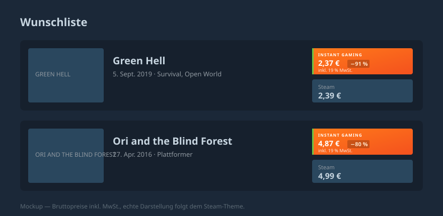

# IG Deals for Steam

[](https://github.com/fabioudev/steam-ig-deals/actions/workflows/ci.yml)

**Instant Gaming prices on your Steam wishlist and store pages.**

A [Millennium](https://steambrew.app) plugin that is meant to show current
Instant Gaming prices and discounts next to the games you are already looking
at — no manual searching, no copy-pasting titles.

> **Status: pre-alpha.** Only the foundation exists: design, tooling, CI,
> tests and documentation. The plugin is not usable yet and has not been
> published. Everything listed under planned features is a goal, not a
> shipped capability.



## Planned features (v1)

- Orange Instant Gaming badge above every wishlist price, showing the gross
  price (incl. VAT) and savings vs. Steam
- Price line on store app pages, placed above the purchase box, with a direct
  link to the product
- Optional "Rabatt inkl. IG" sort entry in Steam's sort menu that ranks wishlist
  cards by the best discount across Steam and Instant Gaming; the sort button
  label reflects the active IG choice
- Local cache, configurable region/currency, no account, no telemetry
- Windows and Linux, one plugin, no background service

These are not implemented yet. See the [milestones](docs/design.md#milestones)
for the order in which they are being built.

## Requirements

To run the plugin (once released):

- Steam desktop client
- [Millennium](https://docs.steambrew.app/users/getting-started/)
  - Linux: AUR package (Flatpak and Snap builds of Steam are not supported)
  - Windows: official installer

To build from source:

- Node.js >= 20 and npm
- Git
- LuaJIT for the Lua tests (optional if you only run the TypeScript checks);
  on Debian/Ubuntu: `sudo apt-get install luajit`
- Steam and Millennium only for `npm run dev`; lint, typecheck, tests and the
  build work headless

## Installation

There is no installable release yet: the plugin is not on
[steambrew.app/plugins](https://steambrew.app/plugins) and no GitHub release has
been tagged. The plugin id is `com.fabioudev.igdeals` (see `millennium.toml`).

Until the first tagged release, the only way to run it is from source:

```sh
git clone https://github.com/fabioudev/steam-ig-deals.git
cd steam-ig-deals
npm install
npm run dev
```

`npm run dev` builds the plugin, installs it into the Millennium installation
Starlight detects, and watches for changes. Restart Steam or reload the UI if
Millennium asks you to. Tagged releases will ship a `.star` artifact; the
store listing and end-user installation instructions will be published once
the plugin reaches a usable milestone.

## Development

```sh
npm install
npm run dev        # build + install + watch (needs Millennium + Steam)
npm run check      # lint, typecheck, TypeScript tests, Lua tests
npm run build      # pack into dist/ (scripts/pack.mjs)
```

Individual commands (`npm run lint`, `npm run typecheck`, `npm test`,
`npm run test:lua`) are listed in [CONTRIBUTING.md](CONTRIBUTING.md), together
with the project layout, branch and commit conventions, test rules and
compliance requirements.

CI runs lint, typecheck, tests and the build on Ubuntu and Windows, and the
Lua tests on Ubuntu. The build runs headless; no Steam installation or secrets
are required.

## Documentation

- [docs/design.md](docs/design.md) — goals, non-goals, architecture, matching,
  cache and compliance
- [docs/ipc-contract.md](docs/ipc-contract.md) — RPC shapes shared by the
  webview, the settings page and the Lua backend
- [CONTRIBUTING.md](CONTRIBUTING.md) — development setup and review rules
- [SECURITY.md](SECURITY.md) — reporting, threat model and the
  terms-of-service position
- [CHANGELOG.md](CHANGELOG.md) — release history
- [AGENTS.md](AGENTS.md) — rules for AI coding agents working in this repo

## How it works

The design is a single Millennium plugin with three parts:

- a **webview preload** that observes the wishlist grid and store pages,
  batches requests and renders badges;
- a **React settings page** for region/currency, badge visibility, cache TTL
  and diagnostics;
- a **LuaJIT backend** that queries Instant Gaming's public Algolia search
  index (the same index the website uses), matches Steam titles to products,
  and caches results locally.

Instant Gaming's Algolia key is restricted to its own origin, so browser
requests from Steam are rejected; the Lua backend's HTTP client is the
supported way to make them. External product links open in the system
browser, never inside Steam's embedded Chromium. See
[docs/design.md](docs/design.md) for details, including the matching and
caching risks.

## Privacy

No account, no sign-in, no telemetry, no analytics. The design caches prices
and appids locally in Millennium's plugin data directory, and its only network
requests go to Instant Gaming and its Algolia index. Nothing is uploaded to
the project. The settings page, once implemented, will be able to clear the
price cache.

## Disclaimer and terms of service

This project is not affiliated with, endorsed by, or sponsored by Valve,
Steam, or Instant Gaming. "Steam" and "Instant Gaming" are trademarks of their
respective owners. The plugin only displays publicly available prices and
links to the corresponding store pages.

Instant Gaming has no public API, and its terms of service may prohibit
automated or repeated access. This project assumes personal, low-volume use
with caching, does not redistribute price data, and does not bypass
authentication — but that assumption is not a legal guarantee. Read the
plainly stated position in [SECURITY.md](SECURITY.md#terms-of-service-a-grey-area-stated-plainly)
before using the plugin.

## Contributing

Contributions are welcome. Start with [CONTRIBUTING.md](CONTRIBUTING.md) and
the [design document](docs/design.md). Security issues must be reported
privately as described in [SECURITY.md](SECURITY.md); do not open a public
issue for them.

## License

[MIT](LICENSE)
